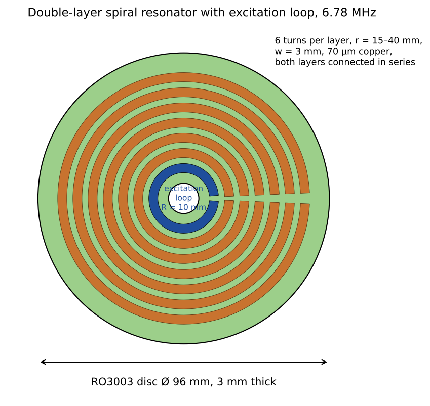

# Double-Layer Spiral Resonator with Excitation Loop, 6.78 MHz (HFSS)

[← Back to Wireless Power Transfer](../README.md)

**Application:** A high-Q printed resonator for magnetic-resonance wireless power transfer in the 6.78 MHz ISM band (AirFuel Resonant), e.g. for charging phones and wearables.
A small non-resonant excitation loop drives the double-layer spiral, which is tuned with an external capacitor.

## Specifications

| Parameter | Value |
|---|---|
| Structure | Double-layer spiral (top and bottom layers in series) plus a single-turn excitation loop |
| Substrate | Rogers RO3003 disc, Ø 96 mm, 3 mm thick |
| Spiral | Turns at r = 15, 20, 25, 30, 35, 40 mm on each layer, trace width 3 mm, 70 µm copper |
| Excitation loop | Radius 10 mm, width 3 mm |
| Tuning capacitor | 75.6 pF (lumped RLC) |
| Excitation | 50 Ω lumped port on the excitation loop |
| Frequency | 6.78 MHz|
| Design variants | Single coil without loop; coil with excitation loop; Tx–Rx link of two coils |
| Year of design | 2016 (ANSYS Electronics Desktop 2016 R2) |

## Source file (download to simulate)

| File | Description |
|---|---|
| [`Double_Layer_Spiral_With_Excitation.aedt`](Double_Layer_Spiral_With_Excitation.aedt) | Electronics Desktop project with all variants |

Open with ANSYS HFSS / Electronics Desktop. The geometry uses the ACIS kernel, so AEDT 2025 R1 and later cannot open it directly: open and save it once in AEDT 2024 R2 (or earlier) to convert it to Parasolid. Simulation results are not included; re-run the analysis setups to regenerate them.
