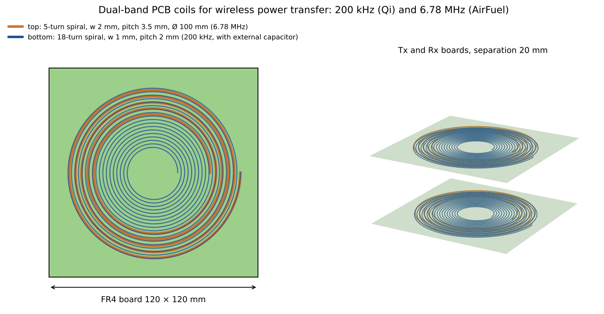

# Dual-Band PCB Coils, 200 kHz and 6.78 MHz (HFSS)

[← Back to Wireless Power Transfer](../README.md)

**Application:** A dual-standard wireless charging coil that supports both inductive (Qi, ~100–205 kHz) and resonant (AirFuel, 6.78 MHz) wireless power transfer on one board.
Each board stacks a low-frequency multi-turn spiral and a high-frequency spiral so one pad can charge devices of either standard.

## Specifications

| Parameter | Value |
|---|---|
| Board | FR4, 120 × 120 mm, 0.5 mm thick |
| 6.78 MHz coil (top) | Circular spiral, 5 turns, outer Ø 100 mm, inner Ø 65 mm, trace 2 mm, pitch 3.5 mm, 35 µm copper |
| 200 kHz coil (bottom) | Circular spiral, 18 turns, outer Ø 100 mm, inner Ø 28 mm, trace 1 mm, pitch 2 mm |
| Link | Identical Tx and Rx boards, 20 mm apart |
| Excitation | 6 lumped ports (coil feeds and capacitor positions) |
| Frequency range | 0.1–9 MHz (LF and HF; 200 kHz and 6.78 MHz bands) |
| Design variants | Full dual-band Tx/Rx link; single Tx (Rx) coil; low-frequency coil alone |
| Year of design | 2018 (ANSYS Electronics Desktop 2017) |

## Source file (download to simulate)

| File | Description |
|---|---|
| [`dual_band_200kHz_6.78MHz.zip`](dual_band_200kHz_6.78MHz.zip) | Zipped Electronics Desktop project (`dual_band_200kHz_6.78MHz.aedt`, 15 MB) with all variants; unzip before opening |

Open with ANSYS HFSS / Electronics Desktop. The geometry uses the ACIS kernel, so AEDT 2025 R1 and later cannot open it directly: open and save it once in AEDT 2024 R2 (or earlier) to convert it to Parasolid. Simulation results are not included; re-run the analysis setups to regenerate them.
