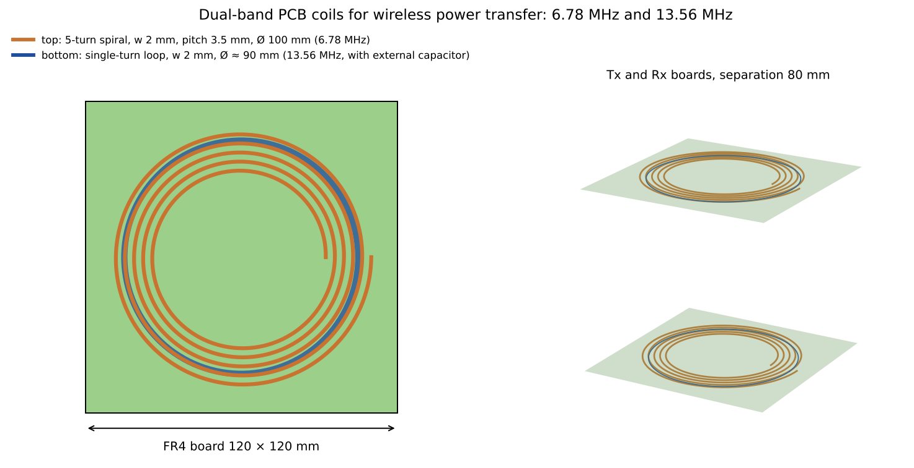

# Dual-Band PCB Coils, 6.78 MHz and 13.56 MHz (HFSS)

[← Back to Wireless Power Transfer](../README.md)

**Application:** A dual-band coil for resonant wireless power transfer at 6.78 MHz (AirFuel) and 13.56 MHz (ISM / NFC wireless charging).
A 5-turn spiral and a single-turn loop share one board, so one pad can transfer power in both HF ISM bands over a larger distance.

## Specifications

| Parameter | Value |
|---|---|
| Board | FR4, 120 × 120 mm, 1 mm thick |
| 6.78 MHz coil (top) | Circular spiral, 5 turns, outer Ø 100 mm, trace 2 mm, pitch 3.5 mm, 35 µm copper |
| 13.56 MHz coil (bottom) | Single-turn loop, outer Ø 100 mm, trace 2 mm |
| Link | Identical Tx and Rx boards, 80 mm apart |
| Excitation | 6 lumped ports (coil feeds and capacitor positions) |
| Frequency | 6.78 and 13.56 MHz ISM bands |
| Design variants | Full dual-band Tx/Rx link; single board |
| Year of design | 2018 (ANSYS Electronics Desktop 2017) |

## Source file (download to simulate)

| File | Description |
|---|---|
| [`dual_band_6.78MHz_13.56MHz.aedt`](dual_band_6.78MHz_13.56MHz.aedt) | Electronics Desktop project |

Open with ANSYS HFSS / Electronics Desktop. The geometry uses the ACIS kernel, so AEDT 2025 R1 and later cannot open it directly: open and save it once in AEDT 2024 R2 (or earlier) to convert it to Parasolid. Simulation results are not included; re-run the analysis setups to regenerate them.
