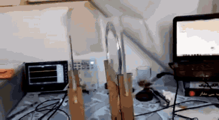
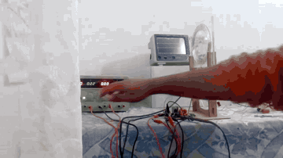
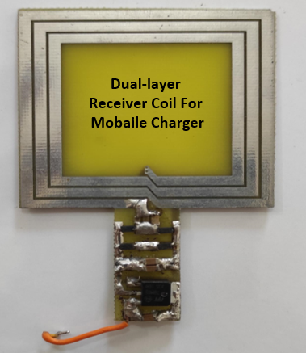
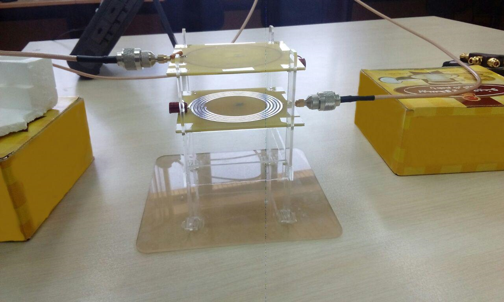
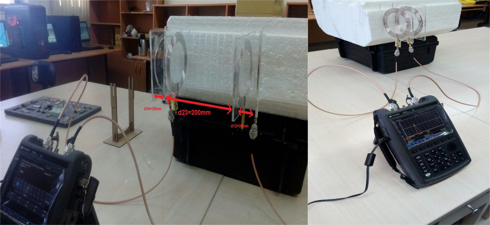

# Fabricated Wireless Power Transfer Prototypes

[← Back to Wireless Power Transfer](../README.md)

## Demo videos

<table>
<tr>
<td align="center"> <a href="../Videos/wpt_mobile_phone_charging.mp4">Wireless charging of a mobile phone (MP4)</a></td>
<td align="center"> <a href="../Videos/wpt_led_load.mp4">Powering an LED load (MP4)</a></td>
</tr>
</table>

## Dual-layer receiver coil for a mobile charger

A rectangular, dual-layer printed receiver coil with an attached rectifier and regulator board, built as the receiving side of a wireless mobile-phone charger.

## Measurement setup for spiral coil links

Two circular printed spiral coils (transmitter and receiver) mounted in an acrylic fixture with adjustable spacing, connected by SMA cables to a vector network analyzer. The setup measures S-parameters, coupling and transfer efficiency against coil separation.

## Four-coil magnetic-resonance link, ~1 MHz

Measured four-coil magnetic-resonance link (drive loop, Tx spiral resonator, Rx spiral resonator, load loop) with drive loop–Tx 30 mm, Tx–Rx 200 mm and Rx–load loop 30 mm, measured with a Keysight FieldFox VNA. Simulation model: [Spiral-Coils-MR-WPT-1MHz](../Spiral-Coils-MR-WPT-1MHz/).
