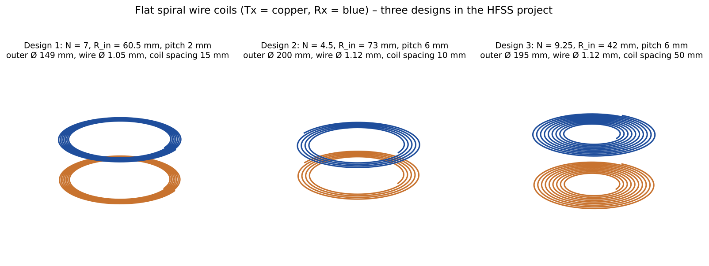

# Flat Spiral Wire Coils for Wireless Power Transfer (HFSS)

[← Back to Wireless Power Transfer](../README.md)

**Application:** Coupled flat spiral coils (transmitter and receiver) for resonant inductive wireless power transfer in the HF range.
The project compares three coil geometries and spacings to study self-resonance, mutual coupling and transfer efficiency.

## Specifications

| Parameter | Design 1 | Design 2 | Design 3 |
|---|---|---|---|
| Coil type | Flat (zero-pitch) spiral of round copper wire, identical Tx and Rx | same | same |
| Turns | 7 | 4.5 | 9.25 |
| Inner radius / pitch | 60.5 mm / 2 mm | 73 mm / 6 mm | 42 mm / 6 mm |
| Outer diameter | ≈ 149 mm | ≈ 200 mm | ≈ 195 mm |
| Wire diameter | 1.05 mm | 1.12 mm | 1.12 mm |
| Tx–Rx spacing | 15 mm | 10 mm | 50 mm |
| Excitation | 50 Ω lumped port, radiation boundary | same | same |
| Frequency range | Adaptive mesh at 30 MHz (HF) | Sweep 1–35 MHz | Sweep 10–16 MHz |
| Year of design | 2017 (HFSS 15) | | |

## Source file (download to simulate)

| File | Description |
|---|---|
| [`flat_spiral_wire_coils.hfss`](flat_spiral_wire_coils.hfss) | Legacy HFSS project with the three designs |

Open with ANSYS HFSS / Electronics Desktop. The geometry uses the ACIS kernel, so AEDT 2025 R1 and later cannot open it directly: open and save it once in AEDT 2024 R2 (or earlier) to convert it to Parasolid. Simulation results are not included; re-run the analysis setups to regenerate them.
