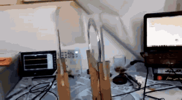
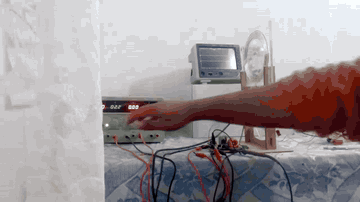
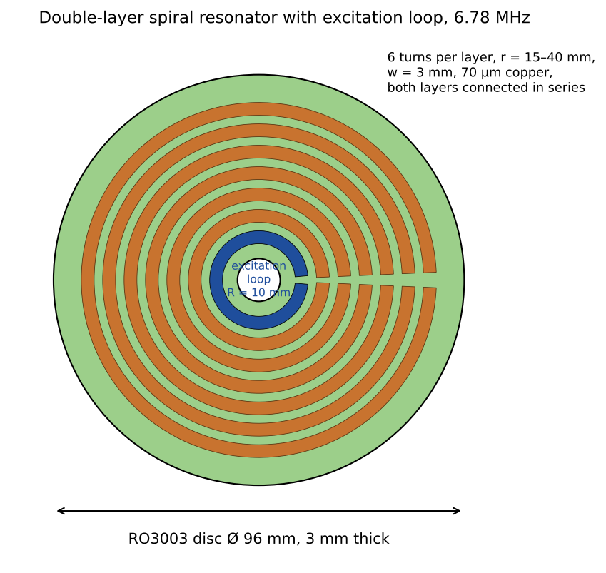
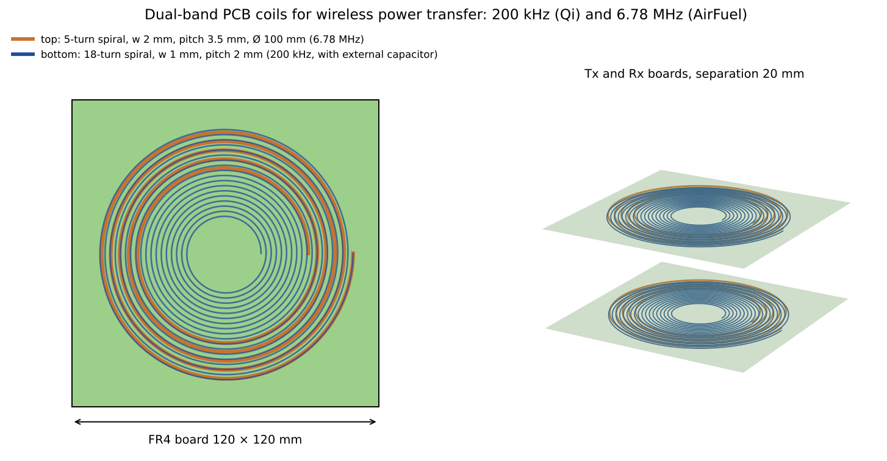
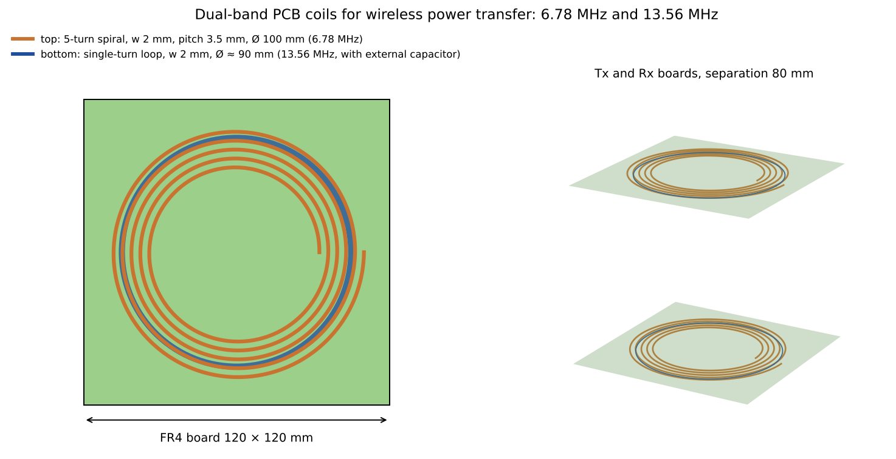
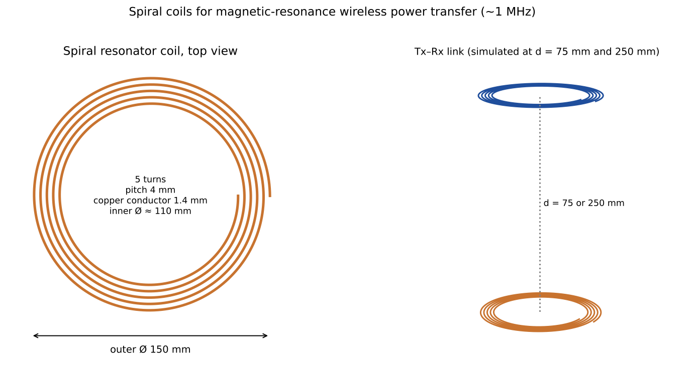
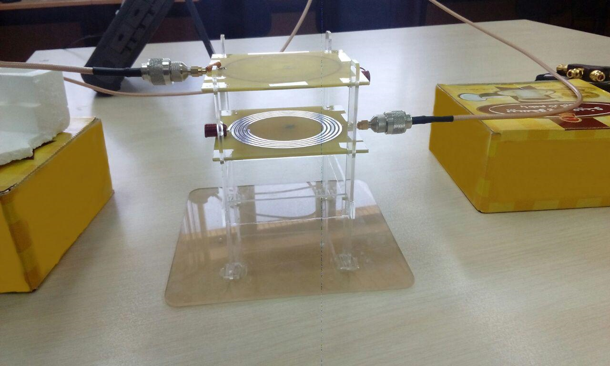
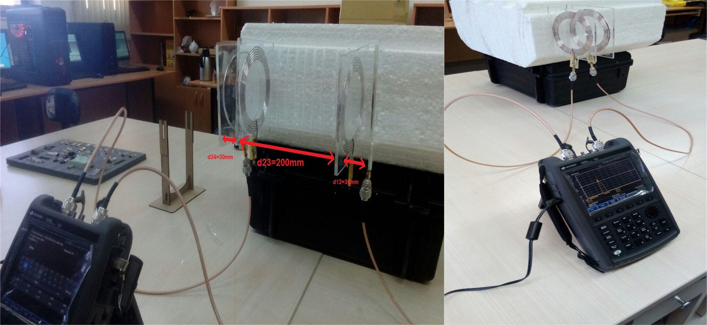

# Wireless Power Transfer

Coil designs for inductive and resonant wireless power transfer (Qi ~200 kHz, AirFuel 6.78 MHz and 13.56 MHz ISM), simulated in ANSYS HFSS, plus demo videos and photos of fabricated prototypes. Each model folder has a structure image, a README with full specifications, and the original HFSS project file so you can download it and re-run the simulation.

## Demo videos

<table>
<tr>
<td align="center" width="50%"><a href="Media/wpt_mobile_phone_charging.mp4"></a><br><b>Wireless charging of a mobile phone</b><br><sub><a href="Media/wpt_mobile_phone_charging.mp4">▶ Full video (MP4)</a></sub></td>
<td align="center" width="50%"><a href="Media/wpt_led_load.mp4"></a><br><b>Powering an LED load wirelessly</b><br><sub><a href="Media/wpt_led_load.mp4">▶ Full video with sound (MP4)</a></sub></td>
</tr>
</table>

## Models

| Model | Type | Frequency (band) | Year |
|---|---|---|---|
| [Planar spiral wire coils](Planar-Spiral-Wire-Coils-13.56MHz/) | Wire coil pairs, 3 designs | 13.56 MHz (ISM) | 2017 |
| [Double-layer spiral resonator](Double-Layer-Spiral-Resonator-6.78MHz/) | PCB resonator + excitation loop | 6.78 MHz (ISM) | 2016 |
| [Dual-band coils 200 kHz / 6.78 MHz](Dual-Band-Coils-200kHz-6.78MHz/) | Qi + AirFuel PCB coils | 0.2 / 6.78 MHz | 2018 |
| [Dual-band coils 6.78 / 13.56 MHz](Dual-Band-Coils-6.78-13.56MHz/) | Dual HF ISM PCB coils | 6.78 / 13.56 MHz | 2018 |
| [Spiral coils for MR-WPT, ~1 MHz](Spiral-Coils-1MHz/) | 4-coil magnetic-resonance link, spiral resonators | 0.5–1.5 MHz (MF) | 2018 |

## Gallery

### Simulation models (HFSS)

<table>
<tr><td align="center"><a href="Planar-Spiral-Wire-Coils-13.56MHz/"></a><br><sub><a href="Planar-Spiral-Wire-Coils-13.56MHz/">Planar spiral wire coils</a></sub></td><td align="center"><a href="Double-Layer-Spiral-Resonator-6.78MHz/"></a><br><sub><a href="Double-Layer-Spiral-Resonator-6.78MHz/">Double-layer spiral resonator</a></sub></td><td align="center"><a href="Dual-Band-Coils-200kHz-6.78MHz/"></a><br><sub><a href="Dual-Band-Coils-200kHz-6.78MHz/">Dual-band coils 200 kHz / 6.78 MHz</a></sub></td></tr>
<tr><td align="center"><a href="Dual-Band-Coils-6.78-13.56MHz/"></a><br><sub><a href="Dual-Band-Coils-6.78-13.56MHz/">Dual-band coils 6.78 / 13.56 MHz</a></sub></td><td align="center"><a href="Spiral-Coils-1MHz/"></a><br><sub><a href="Spiral-Coils-1MHz/">Spiral coils for MR-WPT, ~1 MHz</a></sub></td></tr>
</table>

### Fabricated prototypes and measurements

<table>
<tr><td align="center"><a href="Media/dual_layer_receiver_coil_mobile_charger.png"></a><br><sub>Dual-layer receiver coil for a mobile charger</sub></td><td align="center"><a href="Media/wpt_measurement_setup.png"></a><br><sub>Spiral coil link measurement setup (VNA)</sub></td><td align="center"><a href="Media/four_coil_mr_wpt_1mhz_measurement.jpg"></a><br><sub>Four-coil MR-WPT link, 6.78 MHz (FieldFox VNA)</sub></td></tr>
</table>

## Download and simulate

Open a project file (`.aedt` or `.hfss`) on GitHub and click **Download raw file**, or use **Code → Download ZIP** to get everything. Open it in ANSYS HFSS / Electronics Desktop. The geometry uses the ACIS kernel, so AEDT 2025 R1 and later cannot open these files directly: open and save them once in AEDT 2024 R2 or earlier. Results are not included; re-run the analysis setups to regenerate them.

## Folder structure

```
Wireless-Power-Transfer/
├── Planar-Spiral-Wire-Coils-13.56MHz/
├── Double-Layer-Spiral-Resonator-6.78MHz/
├── Dual-Band-Coils-200kHz-6.78MHz/
├── Dual-Band-Coils-6.78-13.56MHz/
├── Spiral-Coils-1MHz/
└── Media/   (demo videos and prototype photos)
```

See also: [RF-Antenna](https://github.com/fereshtianamir-lab/RF-Antenna) – antenna and transmission-line models in HFSS, CST and FEKO.
