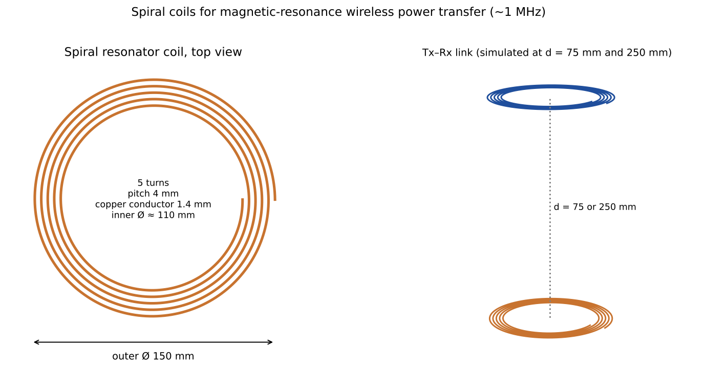

# Spiral Coils for Magnetic-Resonance Wireless Power Transfer, ~1 MHz (HFSS)

[← Back to Wireless Power Transfer](../README.md)

**Application:** Mid-range wireless power transfer with strongly coupled magnetic resonators, using flat spiral coils for charging and powering devices over distances of tens of centimetres.
The measured setup uses four coils (drive loop, Tx resonator, Rx resonator, load loop) to extend the transfer distance.

## Specifications

| Parameter | Value |
|---|---|
| Resonator coil | Flat circular spiral, 5 turns, outer Ø 150 mm, pitch 4 mm (5–6 mm in early variants), copper conductor 1.4 mm |
| Simulated links | Two identical coils at d = 75 mm and d = 250 mm; one variant adds a 50 × 50 mm printed receiver coil (trace 2.4 mm, gap 0.5 mm) |
| Excitation | Lumped ports on the coil feeds, radiation boundary |
| Frequency | 1 MHz|
| Measurement | [Photo in Fabricated-Prototypes](../Fabricated-Prototypes/#four-coil-magnetic-resonance-link-1-mhz). Four-coil link: drive loop–Tx 30 mm, Tx–Rx 200 mm, Rx–load loop 30 mm, measured with a Keysight FieldFox VNA |
| Year of design | 2018 (ANSYS Electronics Desktop 2017) |

## Source file (download to simulate)

| File | Description |
|---|---|
| [`spiral_coil_mr_wpt.aedt`](spiral_coil_mr_wpt.aedt) | Electronics Desktop project with all coil and link variants (renamed from `1.aedt`) |

Open with ANSYS HFSS / Electronics Desktop. The geometry uses the ACIS kernel, so AEDT 2025 R1 and later cannot open it directly: open and save it once in AEDT 2024 R2 (or earlier) to convert it to Parasolid. Simulation results are not included; re-run the analysis setups to regenerate them.
